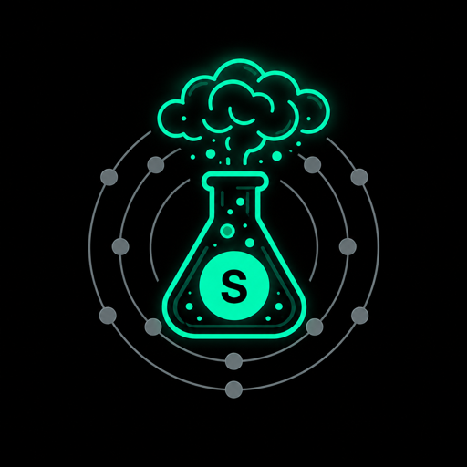

---
hide:
  - navigation
  - toc
---

<div class="hero-section" markdown>

{ .hero-logo }

# NucleantProject

[:material-rocket-launch: New Project](getting-started/new-project.md){ .md-button .md-button--primary }
[:material-cog: nucleant.toml](configuration/nucleant-toml.md){ .md-button }
[:fontawesome-brands-github: GitHub](https://github.com/NucleantUI/NucleantProject){ .md-button }

<div class="hero-stats" markdown>
<div class="stat" markdown>
<span class="stat-value">Gradle</span>
<span class="stat-label">Android</span>
</div>
<div class="stat" markdown>
<span class="stat-value">Xcode</span>
<span class="stat-label">iOS · macOS</span>
</div>
<div class="stat" markdown>
<span class="stat-value">swift run</span>
<span class="stat-label">macOS · Linux</span>
</div>
</div>

</div>

<div class="section-header" markdown>

## :material-lightning-bolt: What nucleant is for

A NucleantUI app is a plain Swift package. Most of the time you don't need any tool for the desktop. You do need one for the platforms that need a native project around the package.

</div>

<div class="grid cards" markdown>

-   :fontawesome-brands-android:{ .lg .middle } **The Gradle project**

    ---

    `nucleant android run` writes `project_dist/gradle`, cross-compiles the app's Swift for every ABI, packs it into an APK with the Activity that starts it, installs it and launches it. SDK, NDK, Java and the Android Swift SDK are installed for you.

    [:octicons-arrow-right-24: Android](platforms/android.md)

-   :fontawesome-brands-apple:{ .lg .middle } **The Xcode project**

    ---

    `nucleant apple sim run`, `apple ios run` and `apple macos run --xcode` generate `project_dist/xcode` with XcodeGen and build a real `.app`. `archive --upload` sends it to App Store Connect.

    [:octicons-arrow-right-24: iOS & macOS](platforms/apple.md)

-   :material-monitor:{ .lg .middle } **The desktop: `swift run`**

    ---

    macOS and Linux build straight from the app's `Package.swift`. `nucleant apple macos run` and `nucleant linux run` are just `swift run` with the pinned toolchain, so plain `swift run` works too.

    [:octicons-arrow-right-24: Desktop](platforms/desktop.md)

-   :material-plus-circle:{ .lg .middle } **One setup for every platform**

    ---

    `nucleant init` writes `nucleant.toml`, a starter app, its `Package.swift` and the Android templates. A desktop-only app gets set up the same way, so Android or the App Store can be added later without starting over.

    [:octicons-arrow-right-24: New project](getting-started/new-project.md)

-   :material-wrench:{ .lg .middle } **A pinned Swift**

    ---

    swiftly, Swift 6.3.3 and the Android and wasm Swift SDKs, installed per project and called by absolute path. Your global `swift` is left alone.

    [:octicons-arrow-right-24: Toolchain](getting-started/toolchain.md)

-   :material-package-variant:{ .lg .middle } **Packages bring their own Android half**

    ---

    Any Swift package in the graph can ship an `Android/java` folder. nucleant compiles it into the app, which is how NucleantBluetooth's callbacks and NucleantApplication's Activity get there.

    [:octicons-arrow-right-24: Package.swift](configuration/package-swift.md)

</div>

---

<div class="section-header" markdown>

## :material-code-tags: Quick Start

From an empty folder to an app on a phone.

</div>

```bash
# 1. A project: uv tracks the nucleant tool, nucleant writes the rest
uv init --bare MyApp && cd MyApp
uv add --dev git+https://github.com/NucleantUI/NucleantProject
uv run nucleant init
uv run nucleant toolchain install      # swiftly, Swift 6.3.3, Swift SDKs

# 2. The desktop: swift run
uv run nucleant apple macos run        # or: uv run nucleant linux run

# 3. Android, or the iOS Simulator
uv run nucleant android run
uv run nucleant apple sim run --name "iPhone 17"
```

---

<div class="section-header" markdown>

## :material-view-grid: How It Works

</div>

<div class="grid cards" markdown>

-   :material-numeric-1-circle:{ .lg .middle } **Initialize**

    ---

    `nucleant init` writes `nucleant.toml`, `Sources/<App>/<App>App.swift`, the app's `Package.swift`, `.swift-version` and two editable Android templates. It never overwrites a file that is already there.

-   :material-numeric-2-circle:{ .lg .middle } **Declare**

    ---

    Dependencies go in `Package.swift`, as in any Swift package. `nucleant.toml` only says which target and entry type to start, and holds the platform settings: package name, bundle id, permissions, API levels.

-   :material-numeric-3-circle:{ .lg .middle } **Generate**

    ---

    Android and Apple get a native project under `project_dist/`. Both are generated, so they can be deleted at any time. What you edit stays at the project root.

-   :material-numeric-4-circle:{ .lg .middle } **Run**

    ---

    Every platform has one `run`, which builds, installs and launches. nucleant drives `adb`, the emulator, `simctl` and `devicectl` for you.

</div>

---

<div class="section-header" markdown>

## :material-compass: Explore the Documentation

</div>

<div class="grid cards" markdown>

-   :material-play-box:{ .lg .middle } **Showcase: NucleantVLC**

    ---

    A media player on libvlc, made by copying NucleantVLC's demo into a nucleant project and running it on Android.

    [:octicons-arrow-right-24: NucleantVLC](showcases/nucleant-vlc.md)

-   :material-bluetooth:{ .lg .middle } **Showcase: NucleantBluetooth**

    ---

    A Bluetooth LE scanner made the same way: the demo's files, the permissions and one manifest provider.

    [:octicons-arrow-right-24: NucleantBluetooth](showcases/nucleant-bluetooth.md)

-   :material-shimmer:{ .lg .middle } **Bundling PyShader**

    ---

    Compile PyShader `.py` shaders to SPIR-V and ship them as the app's resources, loaded the same way on every platform.

    [:octicons-arrow-right-24: PyShader guide](guides/pyshader.md)

-   :material-book-open-variant:{ .lg .middle } **NucleantUI docs**

    ---

    The framework itself: views, `@View`, state, layout, animation, shaders. The DocC articles, tutorials and API reference.

    [:octicons-arrow-right-24: nucleantui.github.io/NucleantUI](https://nucleantui.github.io/NucleantUI/)

-   :material-language-python:{ .lg .middle } **PyShader docs**

    ---

    Shaders in Python syntax compiled to SPIR-V: the language, the standard library, live previews and the SwiftPM plugins.

    [:octicons-arrow-right-24: nucleantui.github.io/PyShader](https://nucleantui.github.io/PyShader/)

-   :material-cog:{ .lg .middle } **nucleant.toml reference**

    ---

    Every table and key: `[toolchain]`, `[swift]`, `[android]`, `[ios]`, `[macos]`, `[linux]`, `[wasm]`.

    [:octicons-arrow-right-24: Configuration](configuration/nucleant-toml.md)

</div>
